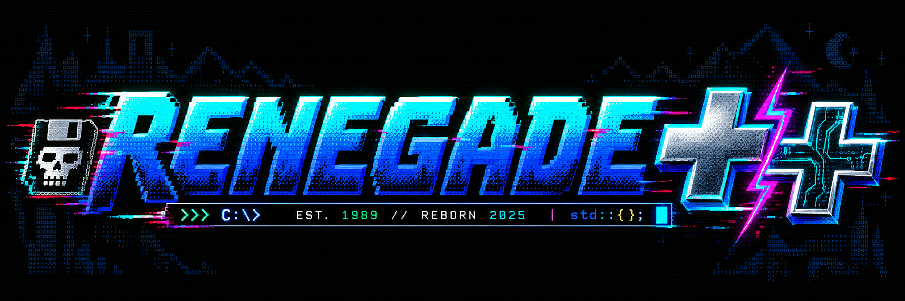
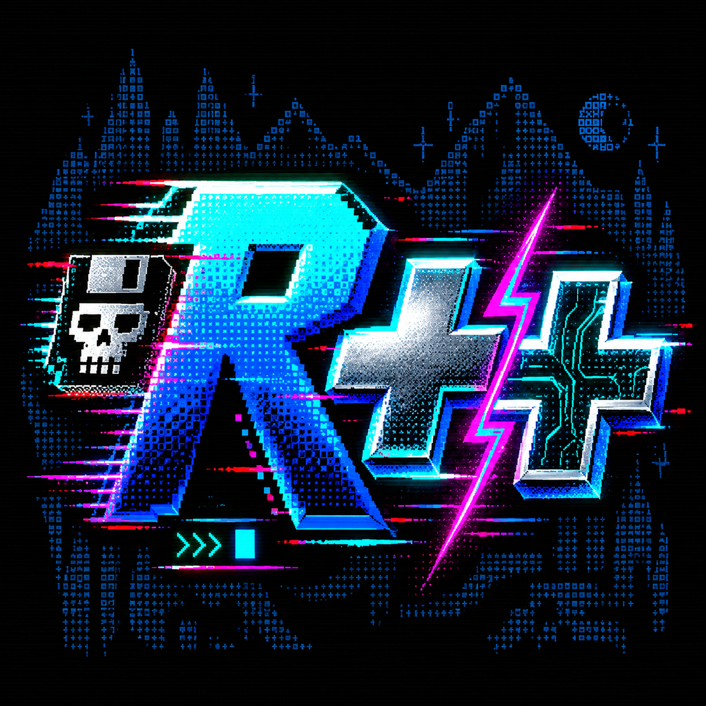

# Renegade++ v1.7.5 for Linux

<p align="center">
  
</p>

<p align="center">
  
</p>

**TCP/IP C++ Port of the Renegade Bulletin Board System**  
Linux · SSH terminal · ANSI/ASCII · multi-node

**Contact:** Stephane Jacob / [jacobstephane@outlook.com](mailto:jacobstephane@outlook.com)

Renegade++ brings the color, menus, and community features of a classic bulletin board to encrypted SSH connections. Callers use a text terminal: no web browser or Linux shell account is needed. The default terminal layout is 80 columns by 25 rows.

## Features

- SSH login, separate BBS accounts, Argon2id password hashes, and SFTP transfers.
- Multi-node status and live chat.
- ANSI/ASCII gallery, welcome panels, message boards, private mail, bulletins, quotes, taglines, polls, one-liners, caller statistics, and a BBS directory.
- SysOp tools for accounts, access rules, message and file areas, moderation, uploads, and system settings.
- A curated set of demo bulletins, quotes, and taglines for a fresh installation. Demo content is clearly labeled and can be replaced or removed.
- A large ANSI/ASCII collection. The main menu, message areas, file areas, and chat now feature selected artwork from the supplied `Roy_EarlyANSI` collection.

## Build

On Debian or Ubuntu, install the build dependencies:

```sh
sudo apt-get update
sudo apt-get install build-essential cmake pkg-config libssh-dev libargon2-dev libsqlite3-dev libarchive-dev openssh-client
```

Then build from this directory:

```sh
cmake -S . -B build -DCMAKE_BUILD_TYPE=Release
cmake --build build -j2
```

## First start

Create a private SSH host key and the first BBS account:

```sh
mkdir -p var data
ssh-keygen -t ed25519 -N '' -f var/ssh_host_ed25519_key
./build/renegade-cpp user add SYSOP
./build/renegade-cpp user sysop SYSOP on
```

Start the BBS:

```sh
./build/renegade-cpp serve
```

Connect from another terminal on the same computer:

```sh
ssh -p 2222 SYSOP@127.0.0.1
```

The server binds to `127.0.0.1:2222` by default. To allow other computers to connect, choose the desired interface or use `--bind 0.0.0.0`, then configure the host firewall for the selected SSH port. Review [the operator and user manual](OPERATOR-USER-MANUAL.md) before exposing a BBS to a network.

Reset a forgotten BBS password locally with:

```sh
./build/renegade-cpp user password SYSOP
```

## Artwork and demo content

Artwork defaults to `assets/ansi/` and can be changed with the `serve` command's `--*-art` options. The menu screens use selected files from `assets/ansi/imported/Roy_EarlyANSI/`; the complete collection remains available in the ANSI/ASCII gallery. See [the artwork notes](assets/ansi/README.md) and [credits](CREDITS.md).

The server reads bulletin panels from `bulletins/`, quote text from `quotes/`, and taglines from `taglines/`. Add `.ANS`/`.ASC` files for bulletins and one `.TXT` file per quote or tagline. Use `--bulletin-dir`, `--quote-dir`, or `--tagline-dir` to select other folders.

## Documentation

- [Operator and User Manual](OPERATOR-USER-MANUAL.md) — installation, configuration, caller features, SysOp workflows, CLI administration, backups, and troubleshooting.
- [Linux service deployment](deploy/README.md) — running the BBS under systemd.
- [Artwork notes](assets/ansi/README.md) — default panels, imported art, and gallery paths.
- [Credits](CREDITS.md) — Renegade team and ANSI artist acknowledgements.

## Credits and reuse

Renegade BBS was created and maintained by the Renegade Development Team. The selected ANSI panels are credited to Roy in the supplied art collection; individual source filenames and hashes are recorded in `assets/ansi/imported/manifest.json`. See [CREDITS.md](CREDITS.md) for details.

The public repository is rooted in this `cpp/` project directory. The separate `SOURCE/` and `PASCAL/` trees and `Archive.zip` remain outside this repository and are excluded by its ignore rules.

This repository does not yet include a project license. GitHub visibility does not itself grant permission to reuse the code or third-party artwork. Existing copyright and creator notices remain with their respective holders.
